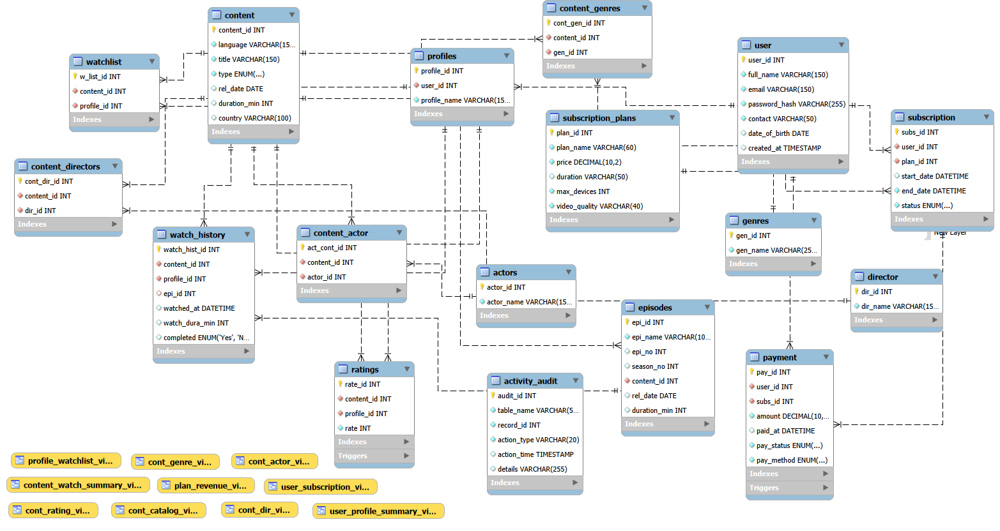

# StreamVault: Relational Database Architecture & SQL Analytics

## 1. Project Overview

**StreamVault** is a relational database project designed to model the backend data architecture of a subscription-based video streaming platform.

The project focuses on designing, implementing, and testing a structured MySQL database capable of managing users, profiles, subscriptions, payments, content, genres, actors, directors, episodes, ratings, watchlists, and viewing activity.

It demonstrates practical database concepts, including relational modelling, primary and foreign keys, integrity constraints, joins, views, stored procedures, triggers, indexing, and SQL-based data analysis.

The database is implemented using MySQL 8.0 and organized into modular SQL scripts to make the project easier to understand, maintain, test, and reproduce.

**Project Status:** Database Implementation and Testing Completed

**Project Type:** Relational Database Design & SQL Analytics

---

## 2. Project Objectives

The primary objectives of StreamVault are:

1. **Relational Database Design:** Design a structured relational database for a subscription-based streaming platform.
2. **Data Integrity:** Maintain consistency through primary keys, foreign keys, unique constraints, check constraints, and composite foreign keys.
3. **Database Operations and SQL Analysis:** Implement SQL queries for data retrieval and analysis using filtering, sorting, joins, aggregate functions, and other SQL techniques.
4. **Advanced SQL:** Demonstrate joins, aggregate functions, subqueries, views, and stored procedures.
5. **Automation:** Use triggers to perform automated database actions in response to selected data modifications.
6. **Performance:** Introduce indexes and examine query execution plans using `EXPLAIN`.
7. **Analytics:** Develop queries that answer business-oriented questions about content, subscriptions, ratings, payments, and user activity.
8. **Testing:** Validate database relationships, constraints, stored objects, and installation reproducibility.

---

## 3. Technology Stack

| Technology | Purpose |
|---|---|
| MySQL 8.0 | Relational database management system |
| SQL | Database definition, manipulation, and querying |
| MySQL Workbench | Database administration and query execution |
| MySQL Command-Line Client | Executing SQL scripts and verifying database objects |
| Git | Version control |
| GitHub | Source code hosting and project documentation |
| Markdown | Technical documentation |

---

## 4. Database Architecture

### 4.1 Database Structure

The StreamVault database contains **17 relational tables**, organized around the major functional areas of a streaming platform.

The tables are grouped into the following domains:

**User and Subscription Management**
- `user`
- `profiles`
- `subscription_plans`
- `subscription`

**Content Management**
- `content`
- `genres`
- `content_genres`
- `episodes`

**Cast and Creator Management**
- `actors`
- `content_actor`
- `director`
- `content_directors`

**User Activity and Payments**
- `watch_history`
- `ratings`
- `watchlist`
- `payment`
- `activity_audit`

### 4.2 Entity-Relationship Diagram

The Entity-Relationship Diagram (ERD) represents the database entities, their attributes, primary keys, foreign keys, and relationships.

The database uses one-to-many, many-to-many, and optional relationships to represent the operations of the streaming platform.

**ER Diagram:**



### 4.3 Major Relationships

The major relationships in the database include:

- `user` --1:N--> `profiles`
- `user` --1:N--> `subscription`
- `subscription_plans` --1:N--> `subscription`
- `user` --1:N--> `payment`
- `subscription` --1:N--> `payment`
- `content` --1:N--> `episodes`
- `content` --N:M--> `genres` through `content_genres`
- `content` --N:M--> `actors` through `content_actor`
- `content` --N:M--> `director` through `content_directors`
- `profiles` --1:N--> `watch_history`
- `content` --1:N--> `watch_history`
- `profiles` --1:N--> `ratings`
- `content` --1:N--> `ratings`
- `profiles` --1:N--> `watchlist`
- `content` --1:N--> `watchlist`

The `watch_history` table also has an optional relationship with `episodes`:

    profiles --1:N--> watch_history --N:1--> content
                              |
                              +--N:1 (optional)--> episodes

The composite foreign key ensures that an episode referenced
in `watch_history` belongs to the same content item.

---

## 5. Database Integrity and Constraints

Database integrity is maintained through relational constraints and validation rules.

### 5.1 Primary Keys

Each table has a primary key to uniquely identify its records.

Auto-incrementing integer identifiers are used where appropriate to simplify record identification and relationships.

### 5.2 Foreign Keys

Foreign keys establish relationships between tables and prevent references to nonexistent records.

Examples include:

- Profiles referencing their associated users.
- Subscriptions referencing users and subscription plans.
- Episodes referencing their parent content.
- Ratings referencing profiles and content.
- Payments referencing users and subscriptions.

### 5.3 Unique Constraints

Unique constraints prevent duplicate values in selected columns and column combinations.

Examples include:

- Unique user email addresses.
- Unique profile names within an individual user's account.
- Unique subscription ownership combinations.
- Unique episode identifiers within their associated content.

The following composite unique constraints support additional relational integrity:

```sql
UNIQUE KEY uq_subscription_owner (user_id, subs_id)
```

```sql
UNIQUE KEY uq_episode_content (content_id, epi_id)
```

### 5.4 Check Constraints and Validation Rules

Check constraints and other column-level restrictions help maintain valid data.

Examples include:

- Ratings restricted to values between 1 and 5.
- Content types restricted to supported categories such as `Movie` and `TV Show`.
- Watch durations restricted to valid values.
- Subscription periods validated to prevent invalid date ranges.

### 5.5 Composite Foreign Keys

Two important composite foreign keys enforce consistency across related records.

**1. Watch History and Episodes**

```sql
FOREIGN KEY (content_id, epi_id)
REFERENCES episodes(content_id, epi_id)
```

This ensures that an episode recorded in watch history belongs to the same content item referenced by that viewing record.

**2. Payments and Subscriptions**

```sql
FOREIGN KEY (user_id, subs_id)
REFERENCES subscription(user_id, subs_id)
```

This ensures that a payment cannot reference a subscription belonging to a different user.

These constraints strengthen relational integrity beyond simple individual-column foreign keys.

---

## 6. Views

Views provide reusable virtual representations of data retrieved from one or more database tables.

StreamVault contains **10 views** designed to simplify access to selected content and related information.

The views are defined in:

```text
database/views/01_content_catalog_view.sql
```

They provide reusable representations of database information and reduce the need to repeatedly write complex retrieval queries.

All 10 views were queried successfully during testing.

---

## 7. Stored Procedures

Stored procedures encapsulate reusable SQL operations within the database.

StreamVault contains **5 stored procedures**, defined in:

```text
database/procedures/01_content_procedures.sql
```

The implemented procedures are:

| Stored Procedure | Function |
|---|---|
| `sp_get_all_cont()` | Retrieves all content records |
| `sp_get_cont_by_type()` | Retrieves content based on content type |
| `sp_get_cont_by_lang()` | Retrieves content based on language |
| `sp_get_cont_ratings()` | Retrieves rating information for a specified content item |
| `sp_get_top_rated_cont()` | Retrieves top-rated content |

### Procedure Testing Results

The following results were obtained using the sample dataset:

| Procedure | Test Result |
|---|---|
| `sp_get_all_cont()` | Returned 12 content records |
| `sp_get_cont_by_type('Movie')` | Returned 7 records |
| `sp_get_cont_by_lang('English')` | Returned 5 records |
| `sp_get_cont_ratings(1)` | Returned The Last Horizon with 2 ratings and an average of 4.50 |
| `sp_get_top_rated_cont(5)` | Returned 5 records |

All five stored procedures were executed successfully.

---

## 8. Triggers and Automated Operations

Triggers are database objects that automatically execute in response to specified database events.

StreamVault contains **2 triggers**, defined in:

```text
database/triggers/01_activity_triggers.sql
```

The implemented triggers are:

| Trigger | Event | Purpose |
|---|---|---|
| `after_rating_insert` | After INSERT on `ratings` | Records a newly inserted rating in `activity_audit`, including its rating ID and rating value. |
| `after_payment_update` | After UPDATE on `payment` | Records a payment status change in `activity_audit`, including the previous and new payment statuses. |

### Trigger Testing

Both triggers were tested using controlled database transactions.

- The rating trigger was tested to verify that inserting a rating generates an audit record.
- The payment trigger was tested to verify that changing `pay_status` generates an audit record containing the previous and new statuses.
- The payment trigger does not generate an audit record when the payment status remains unchanged.
- The test transactions were rolled back after verification to avoid permanently changing the sample data.

---

## 9. Indexing and Query Performance

Indexes are used to improve data retrieval for selected query patterns.

StreamVault contains five explicitly defined performance indexes.

The index definitions are stored in:

```text
database/indexes/01_performance_indexes.sql
```

### 9.1 Implemented Indexes

| Index | Table | Indexed Columns |
|---|---|---|
| `idx_content_title` | `content` | `title` |
| `idx_content_language_type` | `content` | `language, type` |
| `idx_subscription_user_status` | `subscription` | `user_id, status` |
| `idx_watch_history_profile_time` | `watch_history` | `profile_id, watched_at` |
| `idx_payment_status_date` | `payment` | `pay_status, paid_at` |

### 9.2 Query Execution Analysis

The `EXPLAIN` statement was used to examine query execution plans and understand index selection.

The tests demonstrated:

- The content title query used `idx_content_title`.
- The content language and type query used `idx_content_language_type`.
- The watch history query used `idx_watch_history_profile_time`.
- The payment query used `idx_payment_status_date`.
- The subscription query selected `uq_subscription_owner` rather than the explicitly defined `idx_subscription_user_status` in the tested execution plan.

The subscription index was also examined using `FORCE INDEX` to verify its availability.

**Important:** Index selection is determined by the MySQL query optimizer. Creating an index does not guarantee that MySQL will select it for every query. The optimizer considers factors such as table size, available indexes, and estimated query cost.

The performance tests were conducted using the project's sample dataset and should not be interpreted as production-scale benchmarking.

---

## 10. SQL Query and Analytics

The SQL query collection is organized into five categories according to their complexity and analytical purpose.

All query files are located in:

```text
database/queries/
```

| SQL File | Category | Purpose |
|---|---|---|
| `01_basic_queries.sql` | Basic Queries | Filtering, sorting, selecting columns, and limiting results |
| `02_aggregate_queries.sql` | Aggregate Queries | Aggregate functions, grouping, and summarized results |
| `03_join_queries.sql` | Join Queries | Retrieving related information across multiple tables |
| `04_advanced_queries.sql` | Advanced Queries | Subqueries and more complex SQL retrieval operations |
| `05_business_analysis.sql` | Business Analysis | Analysing content, subscriptions, ratings, payments, and user activity |

Together, these query scripts demonstrate SQL-based data retrieval, relational analysis, and business-oriented reporting.

---

## 11. Sample Dataset

The project includes a sample dataset designed to test database relationships, stored objects, and analytical queries.

The initial dataset contains **10 users, 12 content items, 15 profiles, 10 subscriptions, 20 watch-history records, 20 ratings, and 20 watchlist records**, along with sample records for genres, episodes, actors, directors, and payments.

The `activity_audit` table is initially empty and receives records when the corresponding triggers are activated.

---

## 12. Testing and Validation

Testing was performed to verify database functionality, relational integrity, stored objects, query execution, and installation reproducibility.

### 12.1 Database Object Verification

The database was inspected to confirm the creation of:

| Database Object | Verified Count |
|---|---:|
| Tables | 17 |
| Views | 10 |
| Stored Procedures | 5 |
| Triggers | 2 |
| Explicit Performance Indexes | 5 |

### 12.2 Integrity Testing

Validation queries were executed to check for invalid or inconsistent records.

The following checks returned zero violations:

- Invalid ratings.
- Duplicate user email addresses.
- Orphan profiles.
- Orphan subscriptions.
- Invalid watch history references.
- Watch history episode and content mismatches.
- Payment and subscription ownership mismatches.
- Movies containing episode records.
- Invalid watch durations.
- Invalid subscription periods.

### 12.3 Composite Foreign Key Testing

Two important invalid-reference scenarios were tested:

1. Attempting to insert a watch-history record with an episode belonging to a different content item.
2. Attempting to insert a payment record that references another user's subscription.

Both operations were rejected by the database constraints.

### 12.4 Trigger Testing

Both triggers were tested using controlled transactions.

The expected audit records were verified, and the transactions were rolled back after testing.

### 12.5 Stored Procedure and View Testing

All five stored procedures were executed successfully, and all ten views were queried successfully.

### 12.6 Index Testing

`EXPLAIN` was used to inspect index selection for representative queries.

The tests confirmed that several explicitly defined indexes were selected naturally by the optimizer, while the subscription query selected a different available index in the tested plan.

### 12.7 Installation Reproducibility

The database installation process was tested using a separate test database.

The schema and database objects were recreated, and the sample data was loaded to verify that the installation scripts could reproduce the intended database structure.

The separate test database was used for validation without replacing the main project database.

---

## 13. Repository Structure

The project is organized into separate directories for schema definitions, sample data, database objects, queries, documentation, and the ER diagram.

```text
streamvault-database/
|
+-- database/
|   +-- schema/
|   |   +-- 01_create_dbs.sql
|   |   +-- 02_users_subscriptions.sql
|   |   +-- 03_content_catalog.sql
|   |   +-- 04_cast_creators.sql
|   |   +-- 05_users_activity_payments.sql
|   |
|   +-- data/
|   |   +-- 01_users.sql
|   |   +-- 02_subscriptions.sql
|   |   +-- 03_content.sql
|   |   +-- 04_cast_creators.sql
|   |   +-- 05_activity_payments.sql
|   |
|   +-- views/
|   |   +-- 01_content_catalog_view.sql
|   |
|   +-- procedures/
|   |   +-- 01_content_procedures.sql
|   |
|   +-- triggers/
|   |   +-- 01_activity_triggers.sql
|   |
|   +-- indexes/
|   |   +-- 01_performance_indexes.sql
|   |
|   +-- queries/
|       +-- 01_basic_queries.sql
|       +-- 02_aggregate_queries.sql
|       +-- 03_join_queries.sql
|       +-- 04_advanced_queries.sql
|       +-- 05_business_analysis.sql
|
+-- docs/
|   +-- database_documentation.md
|
+-- er-diagram/
|   +-- streamvault_erd.png
|
+-- README.md
+-- .gitignore
```

### Directory Descriptions

- `schema/` contains database and table definitions.
- `data/` contains sample records.
- `views/` contains view definitions.
- `procedures/` contains stored procedure definitions.
- `triggers/` contains trigger definitions.
- `indexes/` contains explicit performance index definitions.
- `queries/` contains SQL scripts organized by query category.
- `docs/` contains detailed technical documentation.
- `er-diagram/` contains the database Entity-Relationship Diagram.

---

## 14. Installation and Verification

For repository cloning, prerequisites, and the complete installation sequence, refer to the [README](../README.md).

After installation, select the database and verify its objects using:

```sql
USE streamvault;

SHOW TABLES;

SHOW FULL TABLES
WHERE Table_type = 'VIEW';

SHOW PROCEDURE STATUS
WHERE Db = 'streamvault';

SHOW TRIGGERS;
```

The completed database should contain 17 tables, 10 views, 5 stored procedures, and 2 triggers.

---

## 15. Project Scope and Limitations

StreamVault is a database-layer implementation designed to demonstrate relational database architecture and SQL functionality.

The project does not currently include:

- A frontend streaming interface.
- A backend web application or REST API.
- Actual video streaming or media storage.
- A real payment gateway integration.
- Authentication and authorization through an application layer.
- Production-scale performance benchmarking.

The sample data is provided for database testing and demonstration purposes. It does not represent real users, subscriptions, payments, or streaming activity.

The project should therefore be understood as a relational database design and SQL analytics implementation, rather than a complete streaming service.

---

## 16. Future Scope

The database can be extended into a more comprehensive streaming platform through future development.

Possible improvements include:

1. **Application Integration:** Develop a backend using Python and Flask, together with a frontend for browsing content, managing profiles, and handling subscriptions.
2. **Recommendation System:** Develop content recommendations using viewing history, ratings, and user preferences.
3. **Analytics Dashboard:** Integrate Power BI or Tableau to visualize content popularity, user activity, subscriptions, and payment trends.
4. **Performance Evaluation:** Test query performance with larger datasets and explore additional indexing and database optimization techniques.

---

## 17. Conclusion

StreamVault demonstrates the practical implementation of a relational database for a subscription-based streaming platform.

The project covers the complete database development workflow, including relational schema design, table creation, sample data insertion, integrity constraints, views, stored procedures, triggers, indexes, SQL querying, and validation.

With 17 tables, 10 views, 5 stored procedures, 2 triggers, and 5 explicitly defined performance indexes, the project provides a structured demonstration of MySQL database concepts.

The testing process also validates important relational rules, including composite foreign-key constraints, data integrity checks, trigger execution, query execution plans, and installation reproducibility.

Overall, StreamVault serves as a practical demonstration of database design, SQL programming, relational integrity, and data analysis using MySQL.

---

**Entity-Relationship Diagram:**

[View StreamVault ER Diagram](../er-diagram/streamvault_erd.png)
